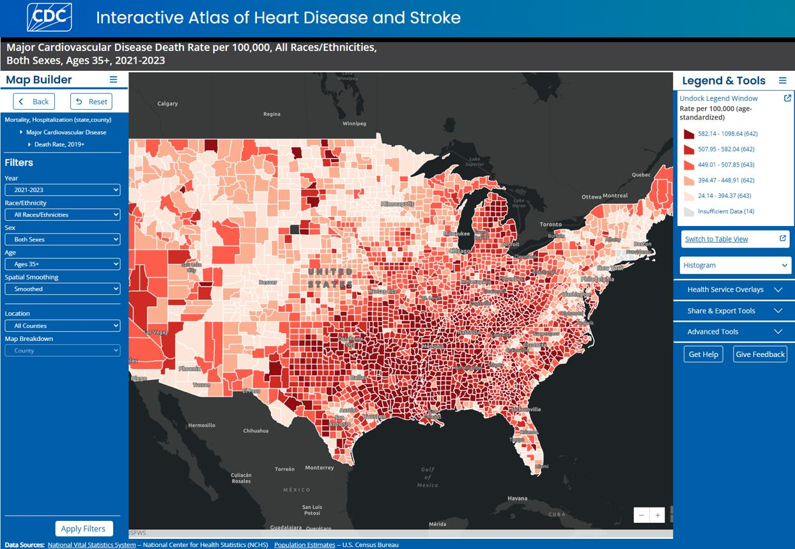

<style>
/* ==================================
   CARDIOVASCULAR WEBSITE DESIGN
================================== */

.cvd-section {
  font-family: inherit;
  margin: 35px 0;
  color: #333;
}

.cvd-section h2,
.cvd-section h3,
.cvd-section h4 {
  color: #7f1d1d;
}

.cvd-header {
  border-left: 6px solid #b22222;
  padding: 10px 20px;
  margin-bottom: 30px;
}

.cvd-header h2 {
  font-size: 2rem;
  font-weight: 800;
}

.cvd-header p {
  color: #555;
  line-height: 1.8;
}

/* STAT CARDS */

.cvd-stats-grid {
  display: grid;
  grid-template-columns: repeat(2, minmax(0, 1fr));
  gap: 20px;
  margin: 25px 0;
}

.cvd-card {
  background: linear-gradient(145deg, #fff5f5, #ffffff);
  border: 1px solid #f1caca;
  border-radius: 16px;
  padding: 25px;
  min-height: 180px;
  transition: all 0.3s ease;
  box-shadow: 0 4px 12px rgba(139, 0, 0, 0.05);
}

.cvd-card:hover {
  transform: translateY(-6px);
  box-shadow: 0 12px 25px rgba(139, 0, 0, 0.12);
  border-color: #b22222;
}

.cvd-number {
  font-size: 2.3rem;
  font-weight: 800;
  color: #b22222;
  line-height: 1.2;
  margin-bottom: 12px;
}

.cvd-card h3 {
  font-size: 1.15rem;
  margin-bottom: 10px;
}

.cvd-card p {
  color: #555;
  line-height: 1.7;
  margin-bottom: 0;
}

/* HIGHLIGHT */

.cvd-highlight {
  background: linear-gradient(135deg, #8b0000, #b22222);
  color: #ffffff;
  padding: 30px;
  border-radius: 16px;
  margin: 35px 0;
  box-shadow: 0 8px 20px rgba(139, 0, 0, 0.15);
}

.cvd-highlight h3 {
  color: white;
  font-size: 1.5rem;
}

.cvd-highlight p {
  line-height: 1.8;
}

/* SECTION HEADERS */

.cvd-subheader {
  margin: 40px 0 20px;
}

.cvd-subheader h2 {
  font-weight: 800;
}

.cvd-subheader p {
  color: #666;
}

/* INTERACTIVE RISK CARDS */

.cvd-risk-grid {
  display: grid;
  grid-template-columns: repeat(2, minmax(0, 1fr));
  gap: 18px;
}

.cvd-risk-card {
  border: 1px solid #e8dede;
  border-top: 5px solid #b22222;
  border-radius: 12px;
  background: white;
  overflow: hidden;
  transition: transform 0.25s, box-shadow 0.25s;
}

.cvd-risk-card:hover {
  transform: translateY(-3px);
  box-shadow: 0 8px 18px rgba(120, 0, 0, 0.09);
}

.cvd-risk-button {
  width: 100%;
  background: #fff;
  border: none;
  padding: 20px;
  text-align: left;
  cursor: pointer;
  color: #7f1d1d;
  font-weight: 700;
  font-size: 1.05rem;
}

.cvd-risk-button:hover {
  background: #fff5f5;
}

.cvd-risk-button .cvd-arrow {
  float: right;
  transition: transform 0.3s ease;
}

.cvd-risk-card.active .cvd-arrow {
  transform: rotate(180deg);
}

.cvd-risk-content {
  display: none;
  padding: 0 20px 20px;
  line-height: 1.7;
  color: #555;
}

.cvd-risk-card.active .cvd-risk-content {
  display: block;
  animation: cvdFade 0.3s ease;
}

@keyframes cvdFade {
  from {opacity: 0; transform: translateY(-5px);}
  to {opacity: 1; transform: translateY(0);}
}

/* DISPARITY TABS */

.cvd-tabs {
  display: flex;
  flex-wrap: wrap;
  gap: 10px;
  margin-bottom: 18px;
}

.cvd-tab {
  background: #f8eaea;
  border: 1px solid #e5bcbc;
  border-radius: 30px;
  padding: 10px 18px;
  color: #7f1d1d;
  font-weight: 600;
  cursor: pointer;
  transition: all 0.2s;
}

.cvd-tab:hover {
  background: #f0cccc;
}

.cvd-tab.active {
  background: #8b0000;
  color: white;
  border-color: #8b0000;
}

.cvd-tab-content {
  background: #fff7f7;
  border-left: 5px solid #b22222;
  border-radius: 12px;
  padding: 25px;
  min-height: 150px;
  line-height: 1.8;
}

.cvd-tab-panel {
  display: none;
}

.cvd-tab-panel.active {
  display: block;
  animation: cvdFade 0.3s ease;
}

/* PREVENTION SWITCH */

.cvd-switch-container {
  background: #fff5f5;
  border-radius: 16px;
  padding: 25px;
  margin: 25px 0;
}

.cvd-switch-buttons {
  display: flex;
  gap: 12px;
  flex-wrap: wrap;
  margin-bottom: 22px;
}

.cvd-switch-button {
  padding: 12px 20px;
  border: 1px solid #b22222;
  border-radius: 30px;
  background: white;
  color: #8b0000;
  font-weight: 700;
  cursor: pointer;
  transition: all 0.2s;
}

.cvd-switch-button.active {
  background: #8b0000;
  color: white;
}

.cvd-prevention-content {
  display: none;
}

.cvd-prevention-content.active {
  display: block;
  animation: cvdFade 0.3s ease;
}

.cvd-prevention-content ul {
  line-height: 2;
}

/* CALL TO ACTION */

.cvd-cta {
  text-align: center;
  background: #fff0f0;
  padding: 30px;
  border-radius: 16px;
  margin: 35px 0;
  border: 1px solid #e8bebe;
}

.cvd-cta h3 {
  margin-bottom: 10px;
}

.cvd-cta p {
  color: #555;
  line-height: 1.7;
}

.cvd-cta-link {
  display: inline-block;
  background: #8b0000;
  color: white !important;
  padding: 12px 22px;
  border-radius: 30px;
  text-decoration: none !important;
  font-weight: 700;
  transition: 0.25s;
}

.cvd-cta-link:hover {
  background: #b22222;
  transform: translateY(-2px);
}

/* REFERENCES */

.cvd-source {
  font-size: 0.9rem;
  color: #666;
  line-height: 1.8;
  margin-top: 25px;
}

/* MOBILE RESPONSIVE */

@media (max-width: 700px) {
  .cvd-stats-grid,
  .cvd-risk-grid {
    grid-template-columns: 1fr;
  }

  .cvd-number {
    font-size: 1.9rem;
  }

  .cvd-header h2 {
    font-size: 1.6rem;
  }

  .cvd-tabs,
  .cvd-switch-buttons {
    flex-direction: column;
  }

  .cvd-tab,
  .cvd-switch-button {
    width: 100%;
  }
}
</style>

<div class="cvd-section">

<!-- INTRODUCTION -->

<div class="cvd-header">

<h2>Cardiovascular Health Burden in the United States</h2>

<p>
Cardiovascular disease (CVD) remains one of the most significant public health challenges in the United States. It includes conditions affecting the heart and blood vessels, such as coronary artery disease, heart failure, hypertension, and stroke.
Explore the statistics below to understand the impact of cardiovascular disease.
</p>

</div>

<!-- STATISTICS -->

<div class="cvd-stats-grid">

<div class="cvd-card">
<div class="cvd-number">#1</div>
<h3>Leading Cause of Death</h3>
<p>
Heart disease remains the leading cause of death in the United States.
</p>
</div>

<div class="cvd-card">
<div class="cvd-number">~1 in 3</div>
<h3>Cardiovascular Deaths</h3>
<p>
Cardiovascular disease accounts for approximately one-third of deaths in the United States.
</p>
</div>

<div class="cvd-card">
<div class="cvd-number">Every 34 Seconds</div>
<h3>Mortality Burden</h3>
<p>
A person in the United States dies from cardiovascular disease approximately every 34 seconds.
</p>
</div>

<div class="cvd-card">
<div class="cvd-number">$168 Billion+</div>
<h3>Economic Burden</h3>
<p>
Heart disease healthcare services and medication costs exceeded $168 billion during 2021–2022.
</p>
</div>

</div>

<!-- WHY IT MATTERS -->

<<<<<<< HEAD
<div class="cvd-card">
=======
<div class="cvd-highlight">
>>>>>>> 917b1d17590d91ac298e64c99733ed3ccf17b7da

<h3>Why Cardiovascular Health Matters</h3>

<p>
Cardiovascular disease impacts individuals, families, communities, and healthcare systems. Despite advancements in treatment and prevention, risk factors such as hypertension, obesity, diabetes, and tobacco use continue to contribute to cardiovascular morbidity and mortality.
</p>

<p>
<<<<<<< HEAD
Public health interventions focused on prevention, health education, and equitable healthcare access are essential for reducing the burden of cardiovascular disease.
=======
Public health interventions focused on prevention, early detection, health education, and equitable healthcare access are essential for reducing the burden of cardiovascular disease.
>>>>>>> 917b1d17590d91ac298e64c99733ed3ccf17b7da
</p>

</div>

<!-- RISK FACTORS -->

<div class="cvd-subheader">

<h2>Major Cardiovascular Risk Factors</h2>

<p>
Select each risk factor to learn how it contributes to cardiovascular disease.
</p>

</div>

<div class="cvd-risk-grid">

<div class="cvd-risk-card">

<button class="cvd-risk-button" onclick="toggleRisk(this)">
Hypertension
<span class="cvd-arrow">⌄</span>
</button>

<div class="cvd-risk-content">
<p>
High blood pressure increases the workload of the heart and can damage blood vessels over time, increasing the risk of heart attack, stroke, and heart failure.
</p>
<strong>Prevention:</strong> Routine blood pressure monitoring, medication adherence, reduced sodium intake, and regular healthcare visits.
</div>

</div>

<div class="cvd-risk-card">

<button class="cvd-risk-button" onclick="toggleRisk(this)">
Diabetes
<span class="cvd-arrow">⌄</span>
</button>

<div class="cvd-risk-content">
<p>
Elevated blood glucose levels can damage blood vessels and increase the likelihood of developing cardiovascular complications.
</p>
<strong>Prevention:</strong> Blood glucose monitoring, early screening, healthy eating, physical activity, and appropriate treatment.
</div>

</div>

<div class="cvd-risk-card">

<button class="cvd-risk-button" onclick="toggleRisk(this)">
Obesity
<span class="cvd-arrow">⌄</span>
</button>

<div class="cvd-risk-content">
<p>
Excess body weight is associated with increased risk of hypertension, diabetes, high cholesterol, and cardiovascular disease.
</p>
<strong>Prevention:</strong> Supportive nutrition environments, physical activity, and access to preventive healthcare.
</div>

</div>

<div class="cvd-risk-card">

<button class="cvd-risk-button" onclick="toggleRisk(this)">
Smoking & Tobacco Use
<span class="cvd-arrow">⌄</span>
</button>

<div class="cvd-risk-content">
<p>
Tobacco use damages blood vessels, increases blood pressure, and contributes to plaque buildup within arteries.
</p>
<strong>Prevention:</strong> Smoking cessation programs, counseling, tobacco control policies, and access to cessation resources.
</div>

</div>

<div class="cvd-risk-card">

<button class="cvd-risk-button" onclick="toggleRisk(this)">
Physical Inactivity
<span class="cvd-arrow">⌄</span>
</button>

<div class="cvd-risk-content">
<p>
Insufficient physical activity contributes to cardiometabolic risk, including obesity, hypertension, and poor cardiovascular health.
</p>
<strong>Prevention:</strong> Safe parks, walking trails, active transportation, and community exercise opportunities.
</div>

</div>

<div class="cvd-risk-card">

<button class="cvd-risk-button" onclick="toggleRisk(this)">
Poor Nutrition
<span class="cvd-arrow">⌄</span>
</button>

<div class="cvd-risk-content">
<p>
Diets high in sodium, saturated fat, added sugars, and processed foods may increase cardiovascular risk.
</p>
<strong>Prevention:</strong> Healthy food access, nutrition education, and policies supporting nutritious food environments.
</div>

</div>

</div>

<!-- DISPARITIES -->

<div class="cvd-subheader">

<h2>Cardiovascular Health Disparities</h2>

<p>
Cardiovascular disease does not affect all populations equally. Explore how social and structural conditions can influence cardiovascular outcomes.
</p>

</div>

<div class="cvd-tabs">

<button class="cvd-tab active" onclick="showCvdTab(this, 'access')">
Healthcare Access
</button>

<button class="cvd-tab" onclick="showCvdTab(this, 'economic')">
Economic Factors
</button>

<button class="cvd-tab" onclick="showCvdTab(this, 'environment')">
Environment
</button>

<button class="cvd-tab" onclick="showCvdTab(this, 'structural')">
Structural Factors
</button>

</div>

<div class="cvd-tab-content">

<div id="access" class="cvd-tab-panel active">

<h3>Healthcare Access</h3>

<p>
Limited access to primary care, preventive screenings, insurance coverage, and affordable medications can delay diagnosis and treatment. Early detection and continuity of care are important for preventing cardiovascular complications.
</p>

</div>

<div id="economic" class="cvd-tab-panel">

<h3>Economic Factors</h3>

<p>
Income, employment, housing stability, and food security influence an individual's ability to maintain cardiovascular health. Financial barriers may limit access to nutritious foods, medications, healthcare services, and opportunities for physical activity.
</p>

</div>

<div id="environment" class="cvd-tab-panel">

<h3>Environmental Conditions</h3>

<p>
Neighborhood environments can influence cardiovascular risk through air pollution, limited access to green spaces, unsafe walking conditions, and reduced availability of healthy foods.
</p>

</div>

<div id="structural" class="cvd-tab-panel">

<h3>Structural & Social Factors</h3>

<p>
Systemic inequalities, discrimination, chronic stress, and unequal resource distribution can contribute to disparities in cardiovascular outcomes. These conditions influence health opportunities across communities and populations.
</p>

</div>

</div>

<!-- PREVENTION TOGGLE -->

<div class="cvd-subheader">

<h2>Prevention & Public Health Strategies</h2>

<p>
Cardiovascular prevention requires action at multiple levels. Select an approach to explore strategies for improving cardiovascular health.
</p>

</div>

<div class="cvd-switch-container">

<div class="cvd-switch-buttons">

<button class="cvd-switch-button active"
onclick="showPrevention(this, 'individual')">
Individual-Level Prevention
</button>

<button class="cvd-switch-button"
onclick="showPrevention(this, 'population')">
Population-Level Prevention
</button>

</div>

<div id="individual" class="cvd-prevention-content active">

<h3>Individual-Level Prevention</h3>

<ul>
<li>Routine blood pressure screening</li>
<li>Monitoring cholesterol and blood glucose</li>
<li>Maintaining a balanced diet</li>
<li>Regular physical activity</li>
<li>Smoking cessation</li>
<li>Medication adherence</li>
<li>Preventive healthcare visits</li>
</ul>

</div>

<div id="population" class="cvd-prevention-content">

<h3>Population-Level Prevention</h3>

<ul>
<li>Community-based cardiovascular health education</li>
<li>Accessible preventive healthcare services</li>
<li>Policies promoting healthy food environments</li>
<li>Tobacco control initiatives</li>
<li>Improved walkability and physical activity environments</li>
<li>Addressing social determinants of health</li>
<li>Reducing healthcare inequities</li>
</ul>

</div>

</div>

<!-- PUBLIC HEALTH SIGNIFICANCE -->

<<<<<<< HEAD
<div class="cvd-card">
=======
<div class="cvd-highlight">
>>>>>>> 917b1d17590d91ac298e64c99733ed3ccf17b7da

<h3>Public Health Significance</h3>

<p>
Cardiovascular disease prevention represents a critical opportunity to improve population health outcomes and reduce premature mortality. By addressing modifiable risk factors and structural barriers to healthcare, public health professionals can implement evidence-based interventions that promote healthier communities.
</p>

<p>
A population health approach emphasizes prevention, equitable access to healthcare, community engagement, health policy, and data-driven decision-making to reduce cardiovascular disease burden.
</p>

</div>

<!-- CTA -->

<div class="cvd-cta">

<h3>Explore the Cardiovascular Data</h3>

<p>
Learn how cardiovascular mortality varies across geographic areas and populations. Use data to identify disparities, understand disease burden, and inform public health action.
</p>

<a href="visualizations.html" class="cvd-cta-link">
  Explore the Data →
</a>

</div>


<script>

// RISK FACTOR EXPANSION
function toggleRisk(button) {
  const card = button.closest(".cvd-risk-card");
  card.classList.toggle("active");
}

// DISPARITY TABS
function showCvdTab(button, tabId) {

  const section = button.closest(".cvd-section");

  section.querySelectorAll(".cvd-tab").forEach(tab => {
    tab.classList.remove("active");
  });

  section.querySelectorAll(".cvd-tab-panel").forEach(panel => {
    panel.classList.remove("active");
  });

  button.classList.add("active");

  const panel = section.querySelector("#" + tabId);

  if (panel) {
    panel.classList.add("active");
  }
}

// PREVENTION SWITCH
function showPrevention(button, contentId) {

  const container = button.closest(".cvd-switch-container");

  container.querySelectorAll(".cvd-switch-button").forEach(btn => {
    btn.classList.remove("active");
  });

  container.querySelectorAll(".cvd-prevention-content").forEach(panel => {
    panel.classList.remove("active");
  });

  button.classList.add("active");

  const content = container.querySelector("#" + contentId);

  if (content) {
    content.classList.add("active");
  }
}

</script>


{width="75%"}

```{=html}
<!-- ===========================
     REFERENCES
=========================== -->
```

::: cvd-references
<h3>Sources & Further Reading</h3>

<ol>

<li>

<a href="https://www.cdc.gov/heart-disease/data-research/facts-stats/index.html" target="_blank">

Centers for Disease Control and Prevention (CDC). Heart Disease Facts.

</a>

</li>

<li>

<a href="https://www.heart.org/en/about-us/heart-and-stroke-association-statistics" target="_blank">

American Heart Association. Heart and Stroke Association Statistics.

</a>

</li>

<li>

<a href="https://newsroom.heart.org/news/heart-disease-remains-leading-cause-of-death-as-key-health-risk-factors-continue-to-rise" target="_blank">

American Heart Association. Heart Disease Remains Leading Cause of Death as Key Health Risk Factors Continue to Rise.

</a>

</li>

</ol>
:::
:::::::::::::::::::::::::::::::::::::::::::::::::::::
::::::::::::::::::::::::::::::::::::::::::::::::::::::
:::::::::::::::::::::::::::::::::::::::::::::::::::::::::::
