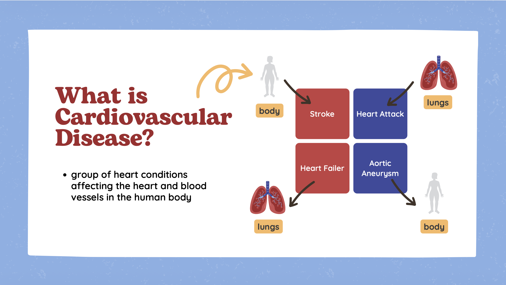

{.lightbox fig-align="center" width="75%"}

# ♥ Stroke

A stroke occurs when blood flow to a part of the brain is interrupted or reduced—either by a blocked blood vessel (ischemic stroke) or a burst blood vessel (hemorrhagic stroke). Because brain cells are deprived of oxygen-rich blood, a stroke impacts the broader body, leading to sudden physical symptoms like paralysis, numbness, or difficulty speaking and walking.

# ♥ Heart Attack

A heart attack (myocardial infarction) happens when a coronary artery becomes blocked, cutting off oxygen-rich blood supply to a section of the heart muscle.The heart relies on oxygenated blood from the lungs to keep itself and the body running. When a blockage prevents the heart muscle from receiving that oxygenated blood, the tissue begins to suffer damage.

# ♥ Heart Failure

Heart failure is a chronic condition in which the heart muscle becomes too weak or too stiff to pump blood efficiently enough to meet the body's needs. The arrow points directly from Heart Failure to the lungs because when the left side of the heart cannot pump blood out effectively, fluid backs up into the blood vessels of the lungs (pulmonary congestion), causing shortness of breath and fatigue.

# ♥ Aortic Aneurysm

An aortic aneurysm is an abnormal bulge or weakening in the wall of the aorta—the body’s largest artery, which carries oxygen-rich blood out of the heart.The arrow points toward the body because the aorta is the main highway delivering blood from the heart to the rest of the body; if an aneurysm ruptures or dissects, it causes life-threatening internal bleeding and cuts off systemic circulation.
